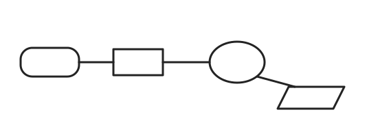
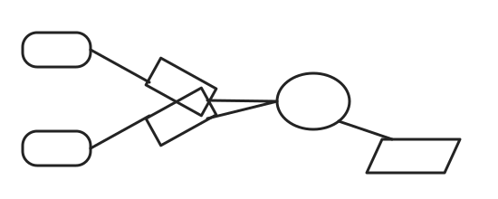
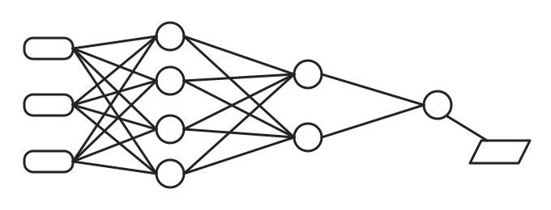

# Paper–Pencil Neural Networks (PPNN)

**A hands-on, number-by-number way to understand neural networks.**

PPNN is an autodidactic and pedagogical project for **working through small neural networks by hand**, using paper, pencil, and reusable laminated diagrams with wet-erase markers. Its aim is to make the parts of a network tangible: inputs, weights, biases, linear combinations, nonlinear activation functions, neuron activations, predictions, signed errors, losses, and cost. Rather than treating a network as a black box, a learner can write the values into the diagram and carry out the computations.

**Status:** Work in progress. This README is a preliminary project introduction, not a finished tutorial or a claim that every diagram and exercise is ready for public use.

## Why paper and pencil?

The point is not to compete with software on speed. It is to see what a neural network is doing, **one number at a time**, including forward propagation and, eventually, manually worked backpropagation. Physical, reusable parts let learners assemble and inspect a computation without immediately hiding it behind matrix notation or code.

The project has grown from handwritten notebooks into laminated working sheets, reusable connector pieces, and SVG versions of its visual symbols. The simple diagrams and the more detailed working sheets are intentionally different levels of abstraction.

## Visual vocabulary

The symbols have distinct roles:

| Symbol | Meaning |
| --- | --- |
| Rounded rectangle | An **input value**; an input is not itself a neuron in this notation |
| Rectangle with a line on each side | A **weight** on a connection, with its own writable area |
| Rectangle with one line extending upward | A **bias**, a trainable parameter belonging to a neuron |
| Oval | A **neuron**, with room to expand its internal calculations |
| Circle | A compact depiction of a neuron in high-level architecture diagrams |
| Parallelogram | The **prediction**, repeating the final neuron's output in its role as \(\hat y\) |
| Trapezoid | The known **target** \(y\), visually distinct from the prediction |
| Cloud marked \(\ell\) | The **loss-function calculation** |
| Loss vector | Individual example losses, prior to aggregation |
| Square marked \(J\) | The aggregate **cost function** |

An additional **neuron-engulfing-bias** illustration shows a rectangular bias parameter inside a small lobe of the neuron. It is a *conceptual explanation*, **not** a replacement for the ordinary bias symbol.

The working convention for the signed prediction error is **prediction minus target**, \(r=\hat y-y\). This is convenient when manually differentiating a half-squared-error loss. The loss and the cost are separate concepts; the cost \(J\) usually aggregates losses over examples.

Layer indices are written below, for example \(a_{(L)}\) for the final layer's activation, leaving superscript space available for component indices. Further standard-ML and Einstein-index conventions remain subjects for development.

## Network architectures

Initial diagrams and physical exercises include:

- **1 input → 1 neuron:** the smallest intended working network.
- **2 inputs → 1 neuron:** two independently weighted inputs converging on one neuron.
- **3–4–2–1:** three inputs, two hidden layers with four and two neurons, and one output neuron. Its compact architecture diagram omits weight rectangles deliberately; the detailed working sheets expose them.
- **XOR and related gates:** proposed extensions, including a network with a hidden layer. These are not yet presented here as completed lessons.

Some architecture drawings stop at the final neuron; others extend to the prediction parallelogram. Additional diagrams connect the prediction to the target, loss calculations, a vector of losses, and the cost \(J\).

### Architecture illustrations (draft)

These **README-specific illustrations** have an opaque white background so
that the near-black outlines stay readable in both GitHub light and dark
mode. They are illustrative reconstructions, not scans of the original
laminated sheets or final canonical SVG exports.

**One input → one neuron → prediction**

**Two inputs → one neuron → prediction**

**3–4–2–1 network → prediction**

The editable working SVGs in Google Drive retain their transparent
backgrounds. These white-backed illustrations are solely for README display.

## Physical toolkit and working method

The physical materials include laminated sheets with writable boxes for intermediate values, and connector cards or strips that can join stages of the computation. The intent is to reuse parts rather than produce a separate fixed sheet for every network configuration. More complete diagrams can expose the internals of a neuron; compact diagrams show only the architecture.

A learner can start with a small network, write inputs and parameters into the available spaces, work through a forward pass, compare prediction and target, and eventually calculate and apply parameter updates by hand.

## Working materials and access

[PPNN working Google Drive folder](https://drive.google.com/drive/folders/1vgHwM8zisOm1rzsQir6JARGiPAV9ngKV) — **restricted access**. At present the original notebooks, laminated-sheet photographs, and some SVG assets are held there; the link is not a promise of public access.

The repository is intended to become a more accessible home for reviewed documentation and diagrams. **Original photographs/notebooks and reconstructed SVGs should remain clearly distinguished**, and unverified matches should not be presented as confirmed originals.

## Documentation

- [Context documents and continuation instructions](docs/context_documents/README.md) — how to preserve the project state across work sessions.
- Future context documents will record decisions, source provenance, unresolved questions, and immediate next steps.

## Current priorities

1. Review and catalog the physical network parts and the corresponding original photographs.
2. Refine and organize the canonical SVG symbols and architecture diagrams.
3. Work through the smallest networks by hand before expanding the teaching examples.
4. Document the additional XOR-related network and the larger 3–4–2–1 working sheets.
5. Add a first continuation-ready lab-notebook context document.

The guiding development principle is **Quick & Reckless / lean-to before cathedral**: get a small, useful exercise working instead of endlessly improving the runway.

---

*This README is an initial draft. Technical conventions and educational examples will be refined alongside the physical materials.*
